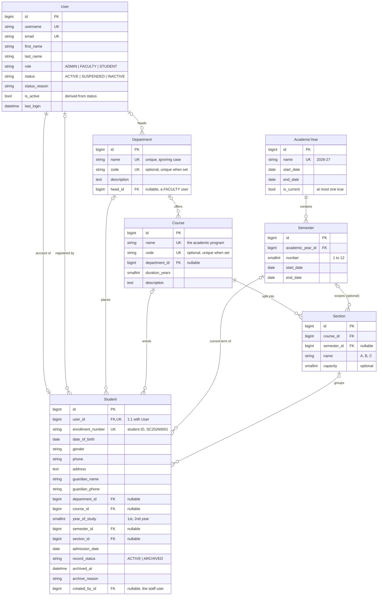
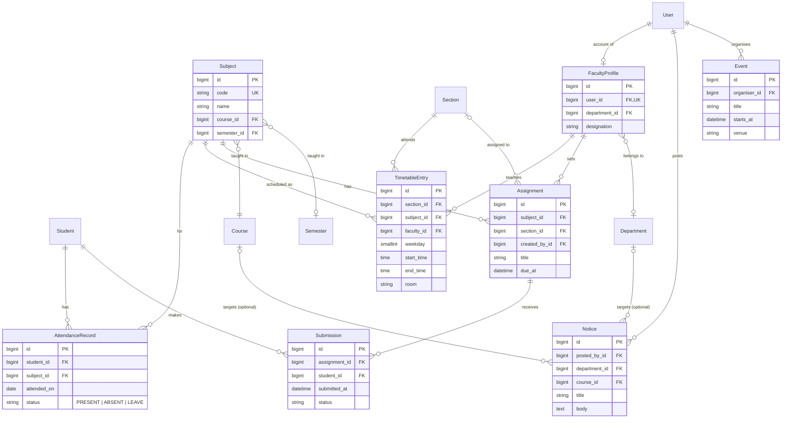

# Smart Campus: Entity-Relationship Diagram

Database: PostgreSQL (Neon). Backend: Django 6 + DRF.
This file shows **what is built today** and, separately, **what is planned**.
It was generated from the live Django models, so the built part matches the code.

Renders on GitHub and in VS Code (Markdown Preview Mermaid Support extension).

---

## 1. Status at a glance

| App | Models | Status |
|---|---|---|
| `accounts` | `User` | Built |
| `students` | `Student` | Built |
| `academics` | `Department`, `AcademicYear`, `Semester`, `Course`, `Section` | Built |
| `faculty` | none | Empty app |
| `attendance` | none | Empty app |
| `timetable` | none | Empty app |
| `assignments` | none | Empty app |
| `notices` | none | Empty app |
| `events` | none | Empty app |
| `dashboard` | none | Empty app (the student dashboard UI exists and uses sample data) |
| `reports` | none | Empty app |

**7 models are built. 8 apps are empty scaffolds.**
(Django's own tables for sessions, admin log and permissions are not shown.)

---

## 2. Built models and their relationships

### Reading the notation
`||` exactly one, `o|` zero or one, `o{` zero or many, `|{` one or many.
`PK` primary key, `FK` foreign key, `UK` unique.

### Foreign keys and what happens on delete

| From | Column | To | On delete |
|---|---|---|---|
| Student | `user_id` | User | CASCADE (the account owns the record) |
| Student | `created_by_id` | User | SET NULL |
| Student | `department_id` | Department | **PROTECT** |
| Student | `course_id` | Course | **PROTECT** |
| Student | `semester_id` | Semester | **PROTECT** |
| Student | `section_id` | Section | **PROTECT** |
| Department | `head_id` | User | SET NULL |
| Course | `department_id` | Department | PROTECT |
| Semester | `academic_year_id` | AcademicYear | PROTECT |
| Section | `course_id` | Course | PROTECT |
| Section | `semester_id` | Semester | PROTECT |

`PROTECT` means a row that is in use cannot be deleted. Academic records are
also never deleted from the API; students are **archived**, not deleted.

### Rules enforced beyond the foreign keys

- **One current academic year.** A partial unique constraint allows only one
  `AcademicYear` with `is_current = true`.
- **Names are unique ignoring case:** department name/code, course name/code,
  academic year name. Empty codes are allowed more than once.
- **One semester number per year.** Unique on (`academic_year`, `number`).
- **Semesters sit inside their academic year.** Odd semesters (1, 3, 5, 7) may
  overlap each other by design.
- **A section name is unique within its course (and semester).**
- **Student placement is consistent.** A student's section must belong to the
  student's course, and to the student's semester if the section is tied to one.
- **`User.is_active` follows `User.status`.** `status` is the source of truth;
  `is_active` is derived on save.
- **Only the role `STUDENT` has a `Student` row.** Every student account is
  created together with its record.

---

## 3. Planned models (not built yet)

> These are proposals so new modules link to the existing tables correctly.
> Nothing below exists in the database. Names and fields can change.

Link students by `student_id`, and subjects, sections and semesters by id, the
same way `Student` links to `Department` and `Course`. **Do not store names.**

### What this unlocks in the UI
The student dashboard already has panels for attendance, today's timetable,
assignments, notices and events. They currently read from
`frontend/src/components/student-dashboard/sampleData.js`. When the models
above exist, replace that file's output with API calls. The shapes were
written to match.

---

## 4. Where things live

| Thing | Path |
|---|---|
| Models | `backend/<app>/models.py` |
| Migrations | `backend/<app>/migrations/` |
| API routes | `backend/<app>/urls.py`, mounted under `/api/` in `backend/config/urls.py` |
| API docs (Swagger) | `/api/docs/` when the server is running |
